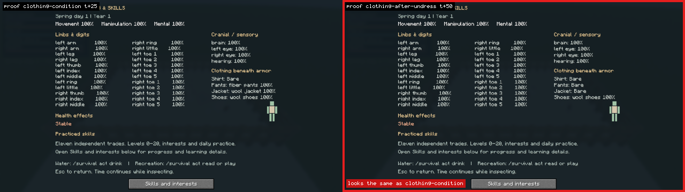



# Clothing and Medical Care

Clothing is the only insulation a body has, and medicine is the only thing that stops bleeding, poison and infection. Both come from the same two raw materials, plant fibre and wool, worked at a loom. Garments go in four clothing slots worn beneath armour. Each adds insulation, which falls as the cloth wears and is cut by a third whenever you are wet. Medical supplies are made from clean cloth and yarrow, each treats exactly one kind of problem, and none of them restores lost health. Recovery is slow and depends on being fed, watered and free of untreated conditions. This page gives the garments, their numbers, the fibre and wool chains, every treatment and the recovery rules.

One game hour is 1,000 ticks and one day is 24,000 ticks. The body model that these items act on is described in [Survival and Physiology](Survival-and-Physiology).

## Clothing slots

| Slot number | Slot | Garments |
| ---: | --- | --- |
| 0 | Shirt | Fibre shirt, wool shirt |
| 1 | Pants | Fibre pants, wool pants |
| 2 | Jacket | Fibre jacket, wool jacket |
| 3 | Shoes | Fibre shoes, wool shoes |

Clothing slots are separate from the armour slots and are shown on the health screen (**H**) as "Clothing beneath armor".

| Action | How |
| --- | --- |
| Put on a garment | Right-click with it in your hand, or hold it and use `/survival act clothe` |
| Change a garment | Put on another garment for the same slot. The old one returns to your inventory with its wear and colour. |
| Take off a garment | `/survival act undress` takes off the outermost (jacket first, then shoes, shirt, pants). `undress_jacket`, `undress_shirt`, `undress_pants` and `undress_shoes` take off a named one. It returns to your inventory with its wear and colour. |
| Dress someone else | Sneak-interact with a humanoid within 3 blocks while holding the garment, or `/survival act clothe <target>`. |
| Undress someone else | `/survival act undress <target>` within 3 blocks. The garment comes to you. |
| Patch a garment | Sneak-use yarn (wool) or cordage (fibre), or `/survival act mend [target]`. See Mending below. |
| Dye a worn garment | Hold a dye in your main hand and use `/survival dye <slot>` with the slot number 0 to 3. One dye is consumed. |

Putting on, taking off, dressing and dyeing all need at least 15% manipulation.

Other people have a say in what they wear:

- Another **player** must be crouching to accept clothing or to hand it over.
- A **companion** who is awake keeps the garment already worn unless the one held out is warmer and sounder. If they accept, the old one comes back to you.
- Nobody awake can be stripped.
- Someone **unconscious or helpless** (mental or manipulation capacity at 5% or less) can be dressed and undressed by another.

## Insulation

Each worn garment adds to your insulation. The total is capped at 0.95. The figures below are for new cloth. A garment loses warmth as it wears, down to half when it is about to fall apart: its insulation is the table value multiplied by (0.5 + 0.5 x condition), where condition runs from 1 for new to 0 for worn out.

| Garment | Insulation | Rule key |
| --- | ---: | --- |
| Wool jacket | 0.35 | `woolJacketInsulation` |
| Wool shirt, pants or shoes | 0.18 each | `woolPieceInsulation` |
| Any fibre garment, including the jacket | 0.06 each | `fiberPieceInsulation` |

| Outfit | Dry | Wet |
| --- | ---: | ---: |
| Nothing | 0 | 0 |
| Full fibre set | 0.24 | 0.16 |
| Wool jacket only | 0.35 | 0.23 |
| Wool jacket over a full fibre set of shirt, pants and shoes | 0.53 | 0.34 |
| Full wool set | 0.89 | 0.58 |

Armour adds no insulation.

### What insulation does in the cold

Below 18 C of effective air temperature, your body's target temperature drops by 0.13 C per degree, multiplied by (1 minus insulation). Hypothermia begins when body temperature falls below 35 C. The table gives the target body temperature at rest, in still air, away from a fire.

| Air temperature | Bare | Full fibre | Full wool, dry | Full wool, wet |
| ---: | ---: | ---: | ---: | ---: |
| 10 C | 36.0 | 36.2 | 36.9 | 36.3 |
| 0 C | 34.7 | 35.2 | 36.7 | 35.8 |
| -10 C | 33.4 | 34.2 | 36.6 | 35.2 |
| -20 C | 32.1 | 33.2 | 36.5 | 34.7 |

A bare body is in trouble below about 3 C. A fibre set buys roughly five degrees. Dry wool holds through any cold shown here, and wet wool fails near -15 C. Wind, in worlds with the regional climate, makes the air count as colder still unless you are sheltered; see [Weather Climate and Geography](Weather-Climate-and-Geography). Standing within 3 blocks of a fire, lava or a lit campfire keeps the target at 37.2 C or above regardless of clothing.

### What insulation does in the heat

Above 26 C insulation works against you: each degree adds 0.08 C multiplied by your insulation, on top of the heat your hydration lets in. Heat stroke begins above 40 C of body temperature. Target body temperature at rest in 40 C air:

| Outfit | Thirst 100 | Thirst 50 | Thirst 30 |
| --- | ---: | ---: | ---: |
| Bare | 38.2 | 39.4 | 39.8 |
| Full fibre | 38.5 | 39.6 | 40.1 |
| Full wool | 39.2 | 40.4 | 40.8 |

Sprinting, climbing or swimming adds another 0.4 C. Drinking is the stronger control in heat, but a full wool set turns a survivable afternoon into heat stroke once you are half dry.

## Wetness

You are wet while you are in water, or while it rains on you with no roof overhead. In worlds with the regional climate, rain counts when its local intensity is above 0.15, and snow does not wet you.

| Effect of being wet | Value |
| --- | --- |
| Clothing insulation | Multiplied by 0.65, for wool and fibre alike |
| Air temperature | Counts as 4 C colder |

Wetness is not stored. You are dry the moment you step under a roof or out of the water. Body temperature itself moves slowly, so the chill you took while wet takes hours to leave.

## Garment wear

A garment wears only while it is worn, and it wears with use, not with the calendar. It has `garmentLifetimeTicks` of walking in it (default 672,000 ticks, which is 28 days). What you do in it changes how fast that goes.

| Activity | Wear compared with walking |
| --- | ---: |
| Asleep | one quarter |
| Standing or sitting | one half |
| Walking | 1 |
| Running or swimming | 2 |
| Climbing | 3 |
| Any of these while wet | half as fast again |

Shoes are different: they wear one and a half times as fast as the rest when you move, and at a twentieth of the walking rate when you are still.

Wounds ruin cloth. A cut, a ball or a bite takes `garmentTearTicksPerDamage` (default 12,000 ticks, half a day) out of the outer garment over the struck limb for every point of health lost: the jacket, or the shirt if there is no jacket, for an arm, and the pants for a leg. Fire scorches every garment you have on by the same amount.

The health screen (**H**) lists each garment with its condition as a percentage:

Worn right through, a garment falls apart, the slot becomes empty and you are told. Wool and fibre garments have the same lifetime. Wear and dye colour stay with the garment when it is taken off, swapped, dropped or traded.

### Mending

| Rule | Value |
| --- | --- |
| Thread | Yarn patches wool, cordage patches fibre. One length is used per patch |
| Which garment | The most worn garment of that cloth |
| What a patch gives back | `garmentMendTicks` (default 134,400 ticks, a fifth of the garment's life) |
| Limit | A patched garment never gets better than `garmentMendFloor` (default 0.2) worn, which is four fifths sound |
| Who can sew | At least 30% manipulation, and not blind |
| Practice | 60 base Weaving XP per patch |

A patch that would do nothing is refused and the thread is kept.

On death, worn garments drop with the body. With the `keepInventory` game rule they stay on.

## Fibre chain

| Step | Where | Input | Output | Work |
| --- | --- | --- | --- | ---: |
| Gather wild plants | Field job | One stand | 2 plant fibre | 40 |
| Gather wild flax (not in winter) | Field job | One stand | 2 flax fibre and 2 flax seeds | 40 |
| Harvest a mature fibre crop | Field job | One plant | 3 plant fibre and 3 seeds | 60 |
| Harvest a mature flax crop | Field job | One plant | 3 flax fibre and 3 seeds | 60 |
| Prepare flax fibre | Crafting grid, or loom process `prepare_flax_fiber` | 1 flax fibre | 1 plant fibre | Grid work, or 400 at the loom |
| Twist cordage | Crafting grid | 2 plant fibre | 2 cordage | Grid work |
| Weave fibre cloth | Loom, `weave_fiber_cloth` | 3 cordage | 1 fibre cloth | 1,000 |

Growing fibre and flax is covered in [Agriculture and Livestock](Agriculture-and-Livestock).

## Wool chain

| Step | Where | Input | Output | Work |
| --- | --- | --- | --- | ---: |
| Shear a sheep | Livestock action with shears | A mature, fed, watered sheep with a regrown fleece | 2 wool | |
| Spin yarn | Loom, `spin_wool` (or `spin_<colour>_wool` for dyed wool) | 1 wool | 4 yarn | 800 |
| Weave wool cloth | Loom, `weave_wool_cloth` | 4 yarn | 1 wool cloth | 1,000 |

A sheared sheep needs 4 well-fed, watered days to regrow its fleece. Shears are iron and need a smith of level 12 to finish, so wool clothing is not a first-week option; see [Skills and Learning](Skills-and-Learning) and [Agriculture and Livestock](Agriculture-and-Livestock).

## Sewing garments

All garments are sewn at the loom from cloth in the main hand and 1 cordage in the offhand. The recipe names use `fiber` or `wool`.

| Garment | Loom process | Cloth | Cordage | Work | Weaving level |
| --- | --- | ---: | ---: | ---: | ---: |
| Shirt | `weave_fiber_shirt`, `weave_wool_shirt` | 4 | 1 | 1,000 | 0 |
| Pants | `weave_fiber_pants`, `weave_wool_pants` | 4 | 1 | 1,000 | 2 |
| Jacket | `weave_fiber_jacket`, `weave_wool_jacket` | 6 | 1 | 1,600 | 4 |
| Shoes | `weave_fiber_shoes`, `weave_wool_shoes` | 2 | 1 | 1,000 | 0 |

| Full set | Cloth | Raw material | Loom work |
| --- | ---: | --- | ---: |
| Fibre | 16 | 52 cordage (48 for cloth, 4 for binding) | 20,600 |
| Wool | 16 | 16 wool (8 shearings) and 4 cordage | 33,400 |

How the loom works:

- A loom is crafted from 4 planks and 2 cordage. It needs no fuel.
- Loom work is manual. It advances only while you are within six blocks, alive and able, at a speed of the lower of your manipulation and mental capacity multiplied by your Weaving work rate (50% at level 0, 100% at level 20). All loom recipes need at least 10% manipulation.
- Right-clicking the loom starts the first recipe that matches what you hold. With cloth in hand that is always the shirt. For pants, jackets and shoes use `/survival produce <recipe>` with the cloth in your main hand and the cordage in your offhand.
- Collect with an empty hand or `/survival collect`. Sneak-right-click or `/survival cancel` returns unfinished inputs.
- Cloth, yarn and garments cannot be made on the crafting grid and are not sold by merchants.

Other loom and workshop rules are in [Building Crafting and Workstations](Building-Crafting-and-Workstations).

## Medical supplies

### Ingredients

| Ingredient | How to get it |
| --- | --- |
| Yarrow leaves | Gather wild yarrow (2 leaves and 2 seeds per stand, not in winter) or harvest a mature yarrow crop (3 leaves) |
| Medicinal leaves | Loom process `prepare_yarrow_leaves`: 1 yarrow leaves gives 1 medicinal leaves, 400 work, trains Medicine. A mature medicinal crop also yields 3 medicinal leaves directly. |
| Clean cloth | Kiln process `sterilize_cloth`: 1 fibre cloth in the main hand and an open jar of boiled water in the offhand give 2 clean cloth. It uses 1 portion of the water, takes 1,000 ticks and runs unattended. The kiln needs at least 1,000 heat ticks. |
| Charcoal | Burned in a kiln; see [Building Crafting and Workstations](Building-Crafting-and-Workstations) |
| Cordage | See the fibre chain above |

Only fibre cloth can be sterilised. The water must be boiled; see [Water Pottery and Food](Water-Pottery-and-Food).

### Recipes

All five are shapeless crafting-grid recipes and take ordinary timed grid work.

| Product | Ingredients | Makes |
| --- | --- | ---: |
| Bandage | 1 clean cloth, 1 cordage | 2 |
| Painkiller | 2 medicinal leaves, 1 clean cloth | 1 |
| Antitoxin | 1 medicinal leaves, 1 clean cloth, 1 charcoal | 1 |
| Antiseptic | 2 medicinal leaves, 1 clean cloth, 1 charcoal | 1 |
| Antibiotic | 3 medicinal leaves, 1 clean cloth, 1 charcoal | 1 |

One fibre cloth (3 cordage) becomes 2 clean cloth, which is 4 bandages or 2 doses of medicine.

## Treatments

| Item | Treats | Effect | Refused when |
| --- | --- | --- | --- |
| Bandage | Bleeding | Bleeding stops completely, whatever its level | The patient is not bleeding |
| Painkiller | Pain from bleeding | For `painkillerTicks` (default 6,000 ticks) the 25% pain penalty on movement and manipulation is lifted | A dose is already active |
| Antitoxin | Poison | Poison ends at once | The patient is not poisoned |
| Antiseptic | Wound infection | The infection ends at once | There is no wound infection |
| Antibiotic | Respiratory and systemic infection, including during incubation | Both infections end at once and the patient is immune to each strain cleared for `immunityTicks` (default 336,000 ticks, 14 days) | The patient has neither infection |

A refused treatment is not consumed. A painkiller is accepted even when nothing hurts, and is then wasted, because pain exists only while bleeding.

What treatments do not do: none of them restores health or repairs a body part. A bandage does not treat wound infection, and antiseptic does not stop bleeding. A deep edged wound can need both.

### How to apply

| Patient | How |
| --- | --- |
| Yourself | Right-click with the treatment in hand, or `/survival act treat` |
| Someone else | Interact with a humanoid within 3 blocks while holding the treatment, or `/survival act treat <target>` |

The person applying the treatment needs at least 15% manipulation. Someone with wrecked hands or a starved body cannot bandage even themselves and needs a companion. Each successful treatment gives the person applying it 100 base Medicine XP. Medicine level does not change what a treatment does.

Non-player actors treat themselves automatically with a useful treatment they hold or find on the ground within 8 blocks, once symptoms show. They also change a garment in rags (under 20% condition) for a sounder one they hold.

## Recovery

| What recovers | Rate | Required conditions |
| --- | --- | --- |
| Health | 1 health every 200 ticks (5 per game hour) | Hunger above 60, thirst above 60, no bleeding, no poison, no systemic infection symptoms, and nothing else dealing physiological damage (wound infection, starvation, hypothermia or heat stroke past its grace period) |
| Body parts | `anatomyRecoveryPerDay` (default 3 points per part per day) | Hunger above 50, thirst above 50, no bleeding, no systemic infection symptoms, no wound infection |
| Eyes at 0 | Never | Permanent for that life |
| Immunity | Lasts 14 days per strain | Lost on death |

Order of care for a wounded person:

1. Bandage first. Bleeding does not stop without one, it costs its level in health every game hour, and it blocks all recovery.
2. Antiseptic if WOUND INFECTION is shown. It also never clears without treatment and blocks recovery.
3. Antitoxin if POISONED, or wait out the 6,000 ticks if health allows.
4. Antibiotic if SYSTEMIC INFECTION is shown. Do not wait for symptoms.
5. Then food and water above 60, warmth, and time. A limb at 0 takes about 33 days to return to 100.

## Tuning

Insulation values, garment lifetime, tearing and mending, painkiller and immunity durations, damage rates and infection chances are in `data/spawn_9b5fbb9/survival/physiology.json`. Loom and kiln processes are in the `production` group of `content_rules.json`; the Weaving gates for pants and jackets and the cordage binding cannot be removed. Override the files in a data pack and run `/reload`. The wet multiplier of 0.65, the 4 C wet chill and the slot layout are fixed in code.

## Commands

| Command | Use |
| --- | --- |
| `/survival act clothe [target]` | Put the held garment on yourself or on a humanoid within 3 blocks |
| `/survival act undress [target]` | Take off the outermost garment; `undress_jacket`, `undress_shirt`, `undress_pants`, `undress_shoes` for a named one |
| `/survival act mend [target]` | Patch the most worn garment with held yarn or cordage |
| `/survival dye <slot>` | Dye the worn garment in slot 0 (shirt), 1 (pants), 2 (jacket) or 3 (shoes) with the held dye |
| `/survival act treat [target]` | Apply the held treatment to yourself or to a humanoid within 3 blocks |
| `/survival health` | Health screen with body parts, capacities and clothing (same as **H**) |
| `/survival inspect <target>` | Status and conditions of an actor within 8 blocks |
| `/survival produce <recipe>` | Start a loom or kiln process, for example `weave_wool_jacket` or `sterilize_cloth` |
| `/survival recipeinfo <recipe>` | Inputs, skill gate and work time for a process |
| `/survival collect`, `/survival cancel` | Take finished output, or take back unfinished input |

The same commands exist for other actors under `/survival control <actor> ...` (operator only).

## What kills you and common mistakes

- **No bandages before a fight.** Any sword, spear, axe, musket ball or shell wound bleeds until it is bandaged. Bandages need cloth, a kiln, boiled water and cordage, so they must be made in advance.
- **Ignoring WOUND INFECTION.** It costs 1 health every 3,000 ticks for ever and stops every kind of recovery until antiseptic is applied.
- **Waiting on a systemic infection.** The symptoms deal 60 health over 2.5 days with healing blocked. The antibiotic works during incubation.
- **Wasting painkillers.** A painkiller does nothing unless you are bleeding, and it never replaces the bandage.
- **Getting rained on in wool.** Wet wool loses a third of its insulation and the air counts 4 C colder. Get under a roof.
- **Wool in the desert.** A full wool set adds about a degree of body heat in 40 C air. Take it off with `/survival act undress` and carry it.
- **Counting on fibre in deep cold.** A full fibre set is worth 0.24 insulation against 0.89 for wool. It helps near freezing and fails below about -2 C.
- **Wearing a garment to destruction.** It gets colder as it wears and then falls apart. Check the condition on the health screen and patch it with yarn or cordage before a winter journey.
- **Hard work in your only coat.** Climbing wears cloth three times as fast as walking, rain half as fast again, and every wound tears it.
- **Sterilising with untreated water.** The kiln refuses anything but an open jar of boiled water.
- **Trying to sew pants by right-clicking the loom.** That starts a shirt. Use `/survival produce weave_fiber_pants`.
