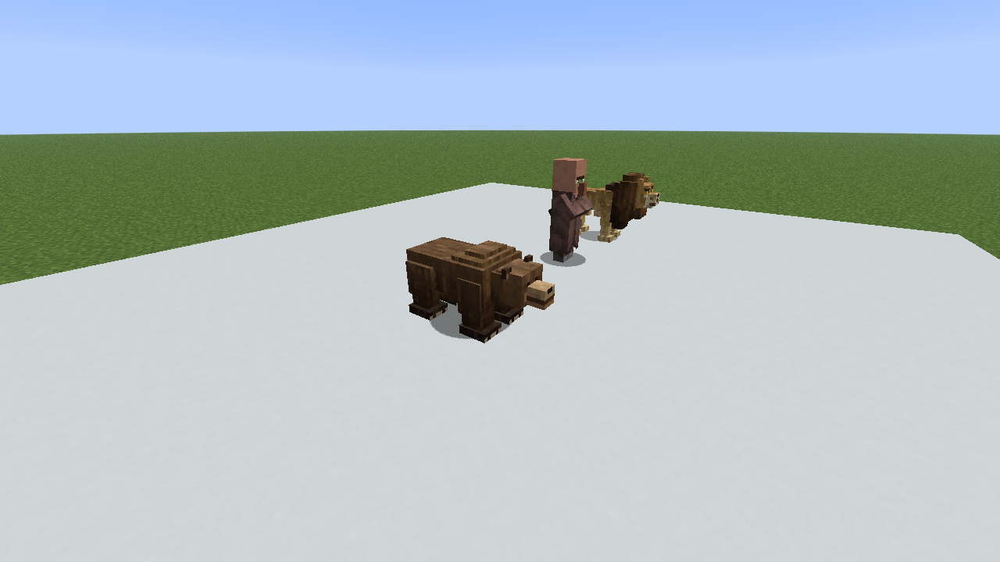
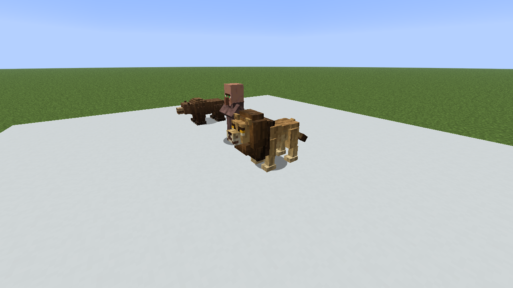
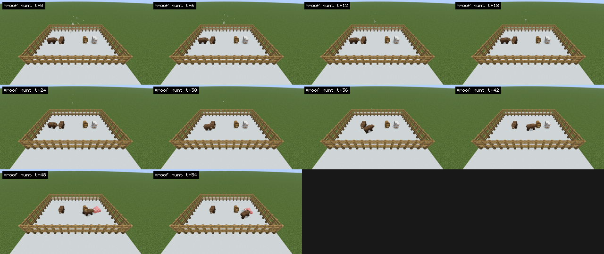



# Predators

Wolves, brown bears, lions and polar bears have to eat. They are not monsters that
attack on sight, and they are not scenery. Each one carries the time of its last full
meal, and almost everything it does follows from that.

## Hunger

- **Fed.** After a full meal the animal leaves flocks and people alone.
- **Hungry.** Once the meal has worn off it takes the nearest prey it can manage.
- **Starving.** After twice that long it takes risks it otherwise would not.

A kill is a full meal for the animal and for every one of its kind within sixteen
blocks. They eat what they kill: the hide and bones are left, the meat is not.

A hungry animal also comes to raw meat or fish lying on the ground and eats a full meal
of it. A carcass or an open larder draws them. A bait can hold one.

## The animals

| Animal | Where it lives | Size | A meal lasts | Prey |
| --- | --- | --- | ---: | --- |
| Wolf | Taiga and forest | 8 health, bite 4 | 3 days | Sheep, goats, pigs, chickens, rabbits. Cattle and horses only as a pack of three |
| Brown bear | Taiga, forest and mountains, alone | 40 health, bite 9. 1.1 m at the shoulder | 2 days | Sheep, goats, pigs, chickens, rabbits, cattle |
| Lion | Savanna, in groups of two to four | 28 health, bite 8. 1.2 m at the shoulder | 4 days | All livestock, cattle and horses included |
| Polar bear | Ice and snow | 44 health, bite 10 | 5 days | All livestock |

A person has 20 health.

## When they attack people

| Animal | It goes for a person when |
| --- | --- |
| Wolf | There is a pack of at least three, the person is alone, and the pack is starving, or it is hungry and the person is hurt or bleeding |
| Brown bear | It is starving. Or, fed or not, someone walks up within five blocks of it |
| Lion | It is hungry and it is night. By day only when starving |
| Polar bear | It is hungry |

Brown bears lie up while it freezes and do not hunt, but a denned bear walked up on
still attacks.

## You cannot outrun them

All four run faster than a person can sprint. A hungry bear covers eight blocks in
about a second:

## What keeps them off

| Defence | How it works |
| --- | --- |
| Fire | None of them goes for anything within six blocks of a lit campfire, a burning block or lava. This protects livestock as well as people. Rain can put the fire out |
| A torch in the hand | A person carrying a torch is left alone |
| Company | They do not approach people standing within eight blocks of one another: two people deter wolves, three deter bears and lions, four deter polar bears |
| Walls and fences | They cannot take stock they cannot reach |
| Wounding them | A badly hurt animal breaks off and runs for a minute rather than fight to the death: a wolf at half its health, a lion at four tenths, a brown bear at a quarter, a polar bear at a fifth |
| Feeding them | A fed animal is not hunting. This is expensive |

An animal that is already on top of its quarry does not let go because a fire or a
friend is near. The defences work at a distance. A brown bear startled at close range
ignores all of them.

## Bites

Teeth and claws open wounds as a blade does.

- A bite bleeds. Bandage it.
- A bite tears the garment over the wound: see [Clothing and Medical Care](Clothing-and-Medical-Care).
- A bite festers three times as often as a clean cut. Carry antiseptic.

## Living with them

- Fold livestock behind a fence at night and keep a roofed fire by the fold.
- Do not leave raw meat lying around the camp.
- Travel in company, or carry a torch.
- Give brown bears room. Five blocks is too close.
- On the savanna, be indoors or beside a fire after dark.
- Tame dogs hunt nobody.

Bears and lions drop hide and bone.
