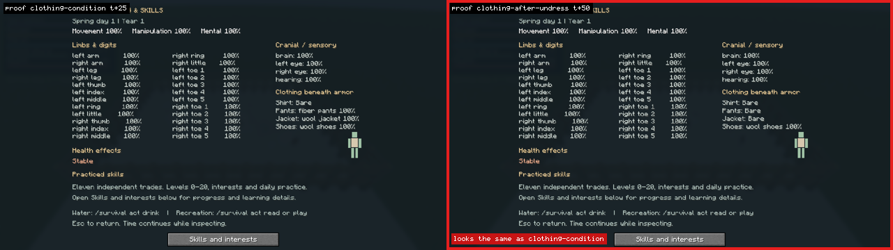



# Clothing

A person wears up to four garments beneath any armour: shirt, pants, jacket and shoes.
They are made of wool or plant fibre on a loom. Clothing is what keeps a body warm.

| Garment | Warmth when new |
| --- | ---: |
| Wool jacket | 35% |
| Wool shirt, pants or shoes | 18% each |
| Fibre garment of any kind | 6% each |

Wet clothing gives two thirds of its warmth.

## Wear

Cloth wears with use, not with the calendar. A garment has 28 days of steady walking
in it. What you do in it changes how fast that goes.

| Activity | Wear compared with walking |
| --- | ---: |
| Asleep | one quarter |
| Standing or sitting | one half |
| Walking | 1 |
| Running or swimming | 2 |
| Climbing | 3 |
| Any of these while wet | half as fast again |

Shoes are different: they wear one and a half times as fast as the rest when you move,
and hardly at all when you are still.

Wounds ruin cloth. A cut, a ball or a bite takes half a day of life out of the outer
garment over the struck limb for every point of damage: the jacket (or the shirt if
there is no jacket) for an arm, the pants for a leg. Fire scorches everything you have on.

## Worn cloth is cold cloth

A garment loses warmth as it wears, down to half its warmth when it is about to fall
apart. The health screen (press **H**) lists each garment with its condition:

When a garment is worn right through it falls apart and is gone. You are told.

## Mending

Patch a garment before it goes.

- Hold **yarn** to patch wool, or **cordage** to patch fibre.
- Sneak and use it, or run `/survival act mend`. To patch someone else's clothing, give
  the command with them as the target.
- The most worn garment of that cloth is patched. One length gives back a fifth of the
  garment's life.
- A patched garment is never new again: mending stops at four fifths sound.
- Sewing needs working hands and eyes. It trains weaving.

## Putting on, taking off, handing over

| Action | How |
| --- | --- |
| Put on | Use the garment. Whatever was in that slot comes back to your hand |
| Take off the outermost | `/survival act undress` (jacket first, then shoes, shirt, pants) |
| Take off a named garment | `/survival act undress_jacket`, `undress_shirt`, `undress_pants`, `undress_shoes` |
| Dress someone else | Sneak and use the garment on them |
| Dye | `/survival dye <0-3>` with a natural dye in hand |

A garment that is taken off keeps its wear and its colour.

Other people have a say.

- Another **player** must crouch to accept clothing or to hand it over.
- A **companion** who is awake keeps the garment already worn unless the one you hold
  out is warmer and sounder. If they accept, the old one comes back to you.
- Nobody awake can be stripped.
- Someone **unconscious or helpless** can be dressed and undressed by another.
- The dead drop what they wore.
